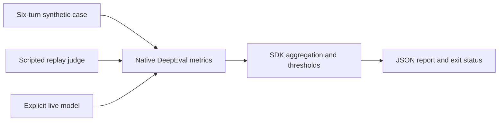

# Conversation Retention Eval

Run three native [DeepEval](https://github.com/confident-ai/deepeval) metrics over
a six-turn synthetic conversation: turn relevance, factual retention, and a
custom boundary rubric. Conversation quality can fail after several turns even
when each response looks plausible in isolation. This project makes those
separate gates visible as JSON scores, reasons, thresholds, and pass/fail results.

The default mode feeds **predetermined fixture judgments** into the actual
DeepEval 4.3.1 metric implementations. It validates SDK construction, structured
response schemas, aggregation, and threshold behavior without making model calls.
It does not evaluate language quality. Explicit live mode uses DeepEval's native
OpenAI model adapter and environment credentials.



## Code map

| Source file | Responsibility and connections |
|---|---|
| `conversation_eval/__init__.py` | Sets telemetry, dotenv, and SDK filesystem controls before importing DeepEval. |
| `conversation_eval/cases.py` | Builds real `ConversationalTestCase` and `Turn` objects for retained and forgotten synthetic cases. |
| `conversation_eval/replay.py` | `DeepEvalBaseLLM` fixture returns schema-validated, prewritten judge responses; rejects unknown SDK schemas. |
| `conversation_eval/runner.py` | Constructs the three native metrics, explicitly selects LLM evaluation mode, executes `.measure()`, and collects results. Builds a live provider adapter only when requested. |
| `conversation_eval/__main__.py` | CLI selects the case and execution mode, optionally writes a report, and returns a quality-gate status. |
| `tests/test_evaluation.py` | Exercises native metric construction and execution with network access denied, verifies aggregation and errors, checks CLI and provider construction. |

## Run

Python 3.10 or newer is recommended; validation used Python 3.13.9.

```powershell
python -m venv .venv
.venv\Scripts\python -m pip install -r requirements.txt
.venv\Scripts\python -B -m conversation_eval
.venv\Scripts\python -B -m conversation_eval --case forgotten --report reports/forgotten.json
.venv\Scripts\python -B -m pytest -q -p no:cacheprovider
```

On macOS/Linux use `.venv/bin/python` in place of `.venv\Scripts\python`.
The retained replay produces scores `1.0`, `1.0`, and `0.9`. The forgotten replay
produces `2/3`, `2/3`, and `0.3`. These are scripted integration expectations,
not measured model accuracy. A successful gate exits 0; a failing gate exits 1;
invalid configuration exits 2. The forgotten fixture intentionally exits 1.
The SDK may print a read-only startup notice before stdout JSON; `--report`
always saves a clean JSON document for machine consumption.

For a real judge, supply your own `OPENAI_API_KEY` securely in the process
environment. Set `CONVERSATION_JUDGE_MODEL` to a model supported by DeepEval's
OpenAI adapter (default `gpt-4o-mini`), then run:

```powershell
.venv\Scripts\python -B -m conversation_eval --live --case retained --report reports/live.json
```

Live mode sends the synthetic transcript and evaluation prompts to the provider
and incurs API charges. No provider is selected by the default replay command.
The project disables DeepEval telemetry and dotenv loading, uses SDK read-only
filesystem mode, and calls standalone metrics rather than hosted result upload.
Only an explicit `--report` writes project results.

## Metrics and limits

- `TurnRelevancyMetric`, threshold 0.7: native sliding-window relevance scoring.
- `KnowledgeRetentionMetric`, threshold 0.7: native fact extraction and attrition
  scoring. Its `yes` verdict means knowledge was lost, so a yes lowers the score.
- `ConversationalGEval`, threshold 0.6: native generated evaluation steps and
  rubric scoring, normalized from 0–10 to 0–1.

The custom boundary rubric is an example of evaluating a synthetic clinical
support conversation. It is not a medical safety certification or patient-facing
advice. No real patient data is included. Live judge quality, calibration,
reproducibility, log-probability weighting, and hosted provider access were not
validated. The replay intentionally does not implement raw token log-probability
responses; G-Eval uses the SDK's schema-score path. Real model scores may differ
and need human-reviewed evaluation data. Temperature zero does not guarantee
identical judgments across provider runs.

The replay is coupled to the pinned SDK schemas and two bundled cases. It must
not be used as a judge for arbitrary input. Unknown response schemas fail loudly.
For new transcripts, create real `ConversationalTestCase` objects and use a live
or independently implemented `DeepEvalBaseLLM` judge, then calibrate thresholds.

Official API references:
[turn relevancy](https://deepeval.com/docs/metrics-turn-relevancy),
[knowledge retention](https://deepeval.com/docs/metrics-knowledge-retention),
[conversational G-Eval](https://deepeval.com/docs/metrics-llm-evals), and
[custom models](https://deepeval.com/guides/guides-using-custom-llms).
